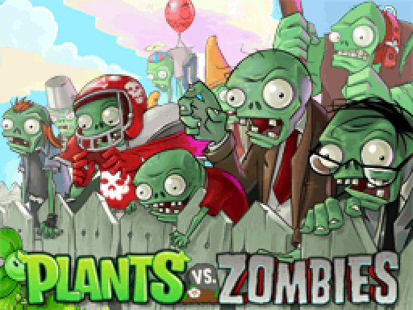

# Wollok Game: PlantasvsZombies

**Integrantes:**
- Mariano Felipe Otero

**Institución: UTN Facultad Regional Buenos Aires**

---

## Objetivo

El objetivo del juego es prevenir que los *zombies* lleguen al otro lado del jardín y se coman tu cerebro

## Controles

P - pausar/reanudar el juego  
R - reiniciar el juego 

Seleccionar plantas: (click en las cartas de abajo) 
 1 - Girasol  
 2 - Lanzaguisantes 
 3 - Nuez 
 4 - SnowPea 
