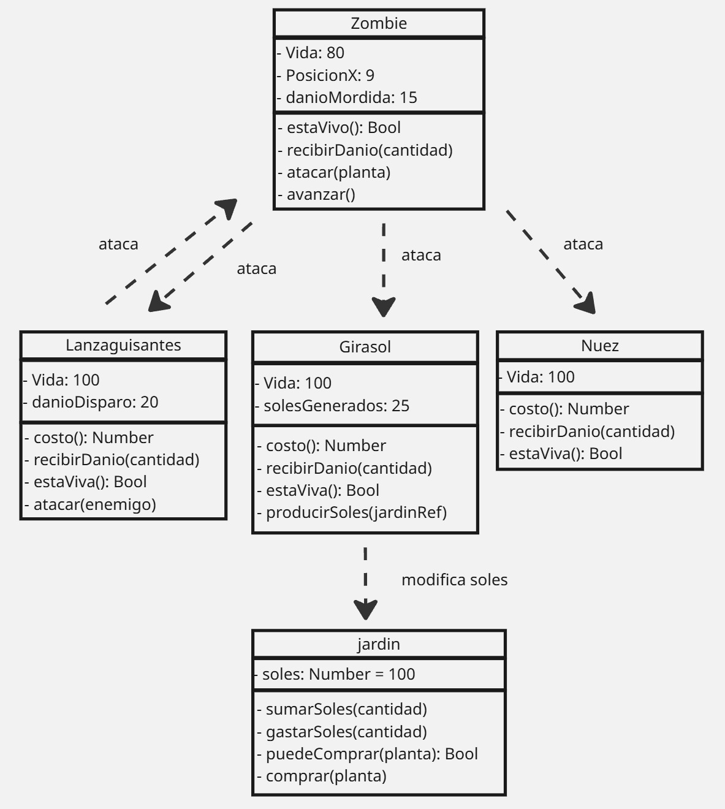

# Explicaciones teóricas

### 1. Polimorfismo
El polimorfismo se aplica en la interacción entre los enemigos (`Zombie`) y los defensores (`lanzaGuisantes`, `Nuez`, `Girasol`). El `Zombie` interactúa con cualquier planta enviándole el mensaje `recibirDanio(cantidad)`. No necesita conocer el tipo concreto de la planta ya que todas entienden el mismo mensaje.

### 2. Encapsulamiento y Estado
El estado interno de cada entidad (como la `vida` de los personajes o la cantidad de `soles` administrados por el `jardin`) esta encapsulado. Toda modificación del estado se realiza a través de métodos con nombres expresivos (`recibirDanio`, `sumarSoles`, `gastarSoles`).

### 3. Delegación de Responsabilidades
El objeto `jardin` delega la validación de costos a la consulta del método `costo()` de cada planta individual. A su vez, el `Zombie` delega el cálculo de reducción de vida a la propia planta cuando la ataca.

# Diagramas

